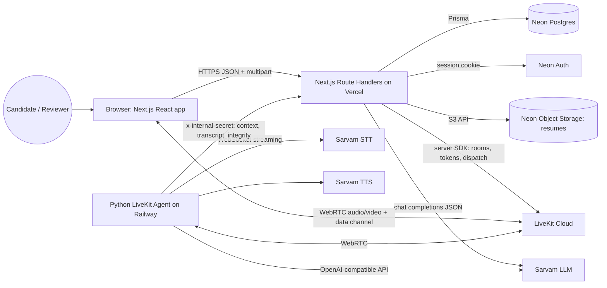
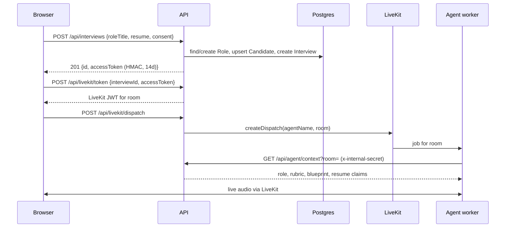
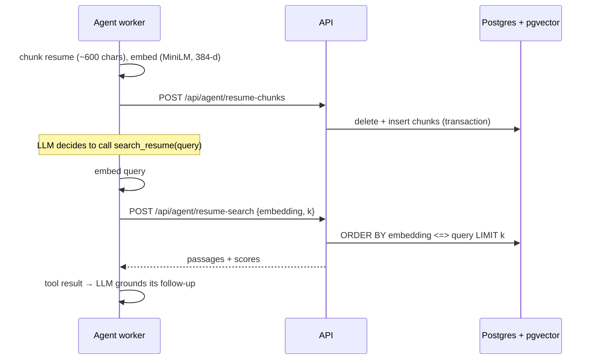
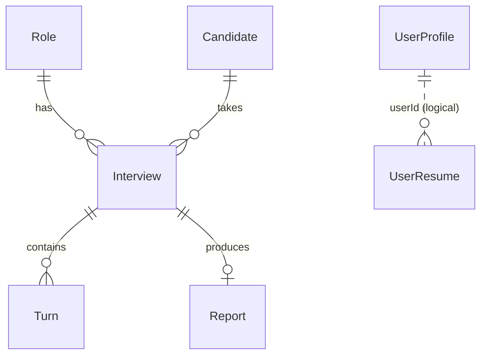

# Ari — High-Level Design

Related: [PRD](./PRD.md) · [Low-Level Design](./LLD.md)

## 1. System context

## 2. Components

| Component | Tech | Responsibility |
| --- | --- | --- |
| **Web client** | React 19, Next.js 16 App Router, Tailwind 4, LiveKit components, TalkingHead (Three.js) | Views for practice, profile, roles, interviews, live room and report; device checks; consent; avatar lip-sync |
| **API layer** | Next.js Route Handlers (`app/api/**`), Node runtime | REST endpoints, auth checks, validation, persistence, LiveKit orchestration, report generation |
| **Voice agent** | Python, LiveKit Agents, custom `SarvamRealtimeSTT` plugin | Joins the room, streams STT, runs the interviewer LLM, speaks with TTS, posts final turns back to the API |
| **Database** | Neon Postgres via Prisma ORM | Roles, candidates, interviews, turns, reports, user profiles and resumes |
| **Auth** | Neon Auth (cookie session) | Identity for hiring and profile features |
| **Object storage** | Neon Object Storage (S3-compatible, private bucket) | Original resume files |
| **Realtime media** | LiveKit Cloud (WebRTC SFU) | Audio and video between browser and agent; data messages for agent state and captions |
| **AI services** | Sarvam STT, LLM, TTS | Speech recognition, interviewer reasoning, report writing, speech synthesis |

## 3. Key flows

### 3.1 Start an interview

### 3.2 Conversation loop

1. Candidate audio → LiveKit → agent → Sarvam streaming STT (WebSocket).
2. Final transcript → interviewer LLM (stage-aware system prompt) → reply text → Sarvam TTS → LiveKit → browser avatar.
3. On each completed turn the agent `POST`s `/api/agent/transcript`. The API writes the Turn and advances the interview stage in one transaction.
4. Agent state (listening, thinking, speaking) and interim captions go to the browser over the LiveKit data channel. They are never persisted as evidence.

### 3.2a Resume retrieval (RAG + function calling)

### 3.3 End and report

1. Browser `POST /api/livekit/end` → room deleted, status set.
2. Browser `GET /api/interviews/:id/report` → API loads final turns and rubric, calls the Sarvam LLM with `response_format: json_object`, validates and coerces the output, keeps only citations that point at real candidate turns, then upserts the Report and marks the interview `COMPLETED`.

## 4. Data model (overview)

Postgres with foreign keys, `ON DELETE CASCADE` from Interview to Turn and Report, and composite indexes on hot paths. Flexible, evolving structures (rubric, blueprint, findings, integrity events) are JSONB columns. Details are in the [LLD](./LLD.md#2-database-schema).

## 5. Cross-cutting concerns

| Concern | Approach |
| --- | --- |
| **AuthN** | Neon Auth session for users; HMAC-SHA256 signed, expiring access token for candidates in an interview; shared secret header for agent-to-API calls |
| **AuthZ** | Owner scoping: roles and interviews are filtered by `ownerId = user.id`; profile and resumes by `userId` |
| **Secrets** | `.env` (git-ignored), `.env.example` documents keys; platform env vars on Vercel, Railway and Render |
| **Errors** | Every handler is wrapped in try/catch with specific status codes (400, 401, 404, 409, 410, 413, 415, 422, 503) and user-readable messages |
| **Resilience** | `AbortSignal.timeout` on LLM calls; httpx timeouts in the agent; deterministic fallback questions; report retry path |
| **Rate limiting** | `lib/rate-limit.ts`: fixed window per IP and bucket, one atomic `INSERT … ON CONFLICT` upsert in Postgres so the limit holds across serverless instances; 429 + `Retry-After`; fails open if the table is unreachable |
| **Password hashing** | Invite passcodes hashed with salted scrypt (`lib/passcode.ts`), verified with `timingSafeEqual` before a LiveKit token is issued |
| **RAG** | Agent embeds resume chunks locally (all-MiniLM-L6-v2, 384-dim, fastembed/ONNX) → stored in `ResumeChunk.embedding vector(384)` with an HNSW cosine index → `search_resume` tool retrieves the top-k passages. Embedding runs in the agent, not on Vercel, because onnxruntime-node would exceed the function size limit |
| **Observability** | Agent emits structured JSON `voice_metrics` logs (ttft, duration, audio duration) per turn |
| **Security headers** | `X-Content-Type-Options: nosniff` and `X-Frame-Options: DENY` on `/api/*` (vercel.json); `poweredByHeader: false` |

## 6. Deployment

| Unit | Target | Notes |
| --- | --- | --- |
| Web + API | Vercel (also Render blueprint and Docker image) | `prisma generate && next build`; report and resume routes get a 60 s max duration |
| Agent worker | Railway (also Render worker and Docker) | Long-running `python worker.py start` |
| Database | Neon | Pooled URL for the app, direct URL for migrations |
| Local | `docker-compose.yml` | Postgres 16, web and agent containers |

## 7. Scalability notes

- The web tier is stateless serverless, so it scales horizontally. The Prisma client is a singleton per instance.
- The agent scales by running more worker processes. LiveKit spreads jobs across available workers.
- The database's busiest query is turns by interview ordered by time, served by the `(interviewId, startedAt)` index.
- Bottlenecks to watch: LLM latency on report generation (synchronous, 45 s timeout) and LiveKit concurrency limits.
